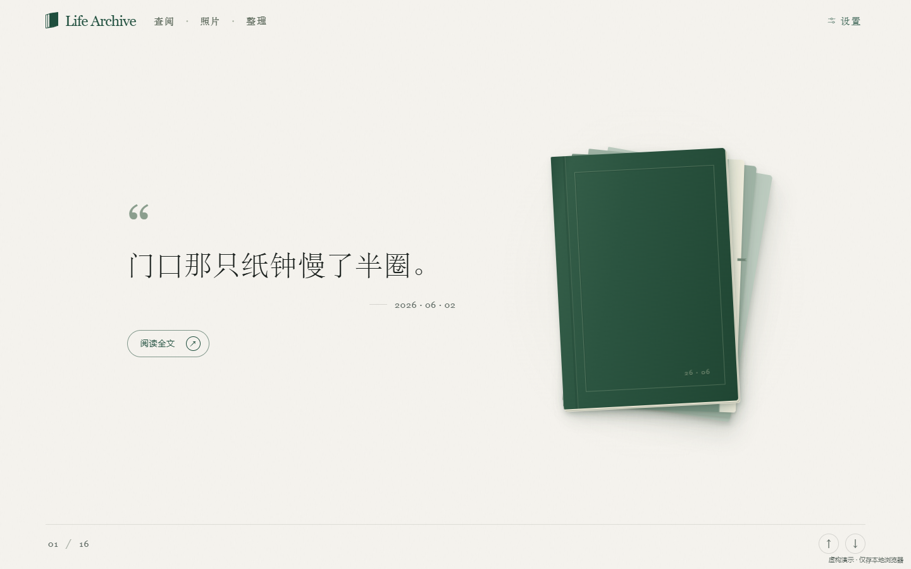
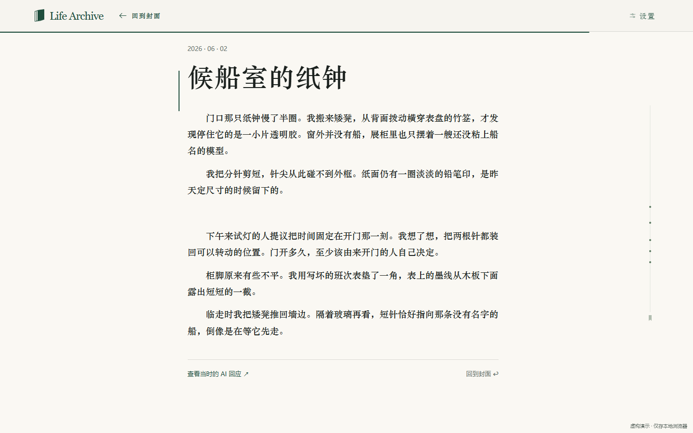

[简体中文](README.md) · [English](README.en.md) · **[Live Demo](https://saltcraft.github.io/life-archive/)** · [](https://github.com/saltcraft/life-archive/actions/workflows/ci.yml) · [](LICENSE) · `v1.1.0`

# Life Archive

Keep an archive your future self can open from time to time. Collect diary entries and photographs, then return to the original through a line you saved or look up a particular entry.



## Archive principles

- Preserve the exact wording, paragraph breaks and order of a collected diary entry. Quotes point back to the source, and photo displays use derived copies.
- Original entries, historical AI responses and later interpretations keep their own provenance. Historical responses have a separate reading view.
- The application runs locally with zero external requests, cloud uploads or telemetry. Reading requires no AI service.

## Reading and organizing in v1.1.0

- Use the magnetic quote transition on the silent stage to encounter another excerpt, or look up a full entry by month or original wording.
- After seven seconds of stillness, or on pressing `F`, the reader fades its controls into the margins. Move the pointer or scroll to bring them back. Select and confirm a quote within a paragraph of the original text.
- Browse albums and loose photographs. Move items to the archive bin, restore them, or confirm permanent deletion in a separate step.
- The local service supports offline directory backups, integrity checks and rehearsals in a separate restore directory.



## Quick start

### A · Fictional demo

Open the [GitHub Pages demo](https://saltcraft.github.io/life-archive/) or download `life-archive-demo-v1.1.0.html` from the [v1.1.0 Release](https://github.com/saltcraft/life-archive/releases/tag/v1.1.0). Once the release attachment is available, double-click it to open it offline. The demo starts with the fictional Paperfold Riverbank archive and keeps changes in the current browser. Clearing site storage resets that copy.

### B · Full local archive

Install Python 3.11+ and Node.js 20.19+ (20.x) or 22.12+ on Windows, macOS or Linux. From the repository root, build in three steps:

```sh
python -m pip install -r studio/backend/requirements.txt
npm --prefix studio/frontend ci
npm --prefix studio/frontend run build
```

Run `./scripts/start.cmd` from PowerShell on Windows, or `./scripts/start.sh` on macOS and Linux. Use `python3` in the installation command if that is the only Python command available. The archive starts empty, ready for its first diary entry or photos. Use `start-demo.cmd` or `start-demo.sh` for the separate local fictional archive.

The default storage root is `data/` under the repository. Set `LIFE_ARCHIVE_DATA_DIR` in the process environment before starting to choose your own directory. Use the same root for the service, backup and restore commands. This example uses two separate directories underneath that root:

```sh
python -B -m studio.backend.backup_restore export_backup data/backup --scope personal
python -B -m studio.backend.backup_restore verify_restore data/backup --root data/rehearsal --scope personal
```

With a custom root, replace the example paths with paths under that root. Use `restore` to reproduce the saved state in a separate, empty directory. `verify_restore` also writes a synthetic entry to the restored copy to check that writes work. Back up the fictional workspace with `--scope fixture`. Backups cover archive records and photo files. Reading preferences are stored separately.

## Local security

The server binds to a random port on `127.0.0.1`. A random session path, same-origin checks and a write token limit access. A strict CSP restricts resource loading. The portable demo CSP blocks network connections. Dependency installation and the initial hosted page load require a connection.

## Technology and license

Python, SQLite, Waitress, Pillow, React, TypeScript, Vite and Framer Motion. See the [design principles](docs/DESIGN_PRINCIPLES.md) for the archive model. The code is available under the [MIT License](LICENSE).
