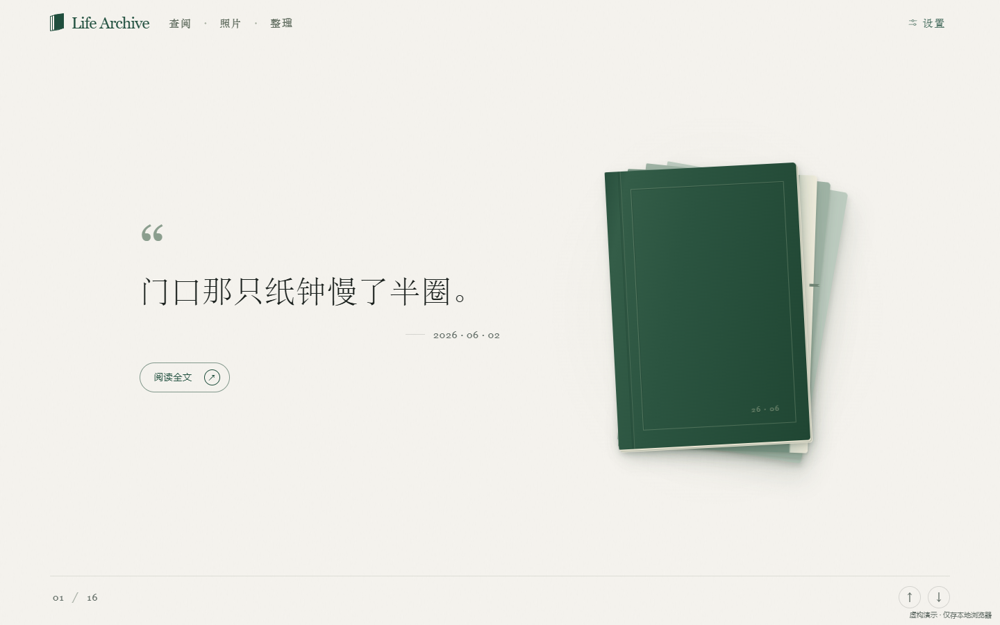
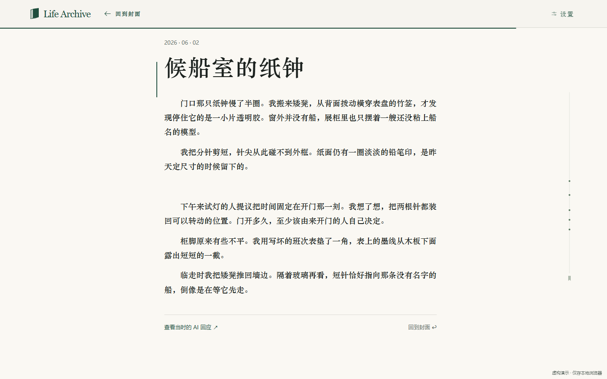

[简体中文](README.md) · [English](README.en.md) · **[在线虚构演示（Live Demo）](https://saltcraft.github.io/life-archive/)** · [](https://github.com/saltcraft/life-archive/actions/workflows/ci.yml) · [](LICENSE) · `v1.1.0`

# Life Archive

为未来的自己留一座可以偶尔翻开的档案。收下日记和照片，日后可以循着一句话回到原文，也可以直接查阅。



## 档案原则

- 收纳后保留原始日记的字句、段落和次序。摘句回指原文，照片展示使用派生副本。
- 日记原文、历史 AI 回应和后期理解各有出处。历史回应保留独立的阅读入口。
- 应用纯本地运行，零外网请求、云端上传和遥测。阅读无需连接 AI 服务。

## v1.1.0 的阅读与整理

- 在静默舞台用磁力翻句邂逅另一条摘录，或按年月及原文字句查阅全文。
- 阅读时静置 7 秒或按 `F` 进入余光留白。移动指针或滚动唤回界面。原文划句窗口支持在单段内选择并确认摘句。
- 照片可独立存在，在影集和散照中翻看。暂存箱支持移出、恢复和再次确认后彻底清除。
- 本地服务支持离线目录级备份、校验和独立还原演练。



## 快速开始

### A · 虚构演示

打开 [GitHub Pages 演示](https://saltcraft.github.io/life-archive/)，或从 [v1.1.0 Release](https://github.com/saltcraft/life-archive/releases/tag/v1.1.0) 下载 `life-archive-demo-v1.1.0.html`。Release 附件发布后，可双击 HTML 离线打开。演示预置「折纸河岸」虚构档案，操作存于当前浏览器。清除站点存储会重置这份副本。

### B · 本地完整档案

在 Windows、macOS 或 Linux 上安装 Python 3.11+ 和 Node.js 20.19+（20.x）或 22.12+。在仓库根目录运行这三条命令完成构建。

```sh
python -m pip install -r studio/backend/requirements.txt
npm --prefix studio/frontend ci
npm --prefix studio/frontend run build
```

Windows 从 PowerShell 运行 `./scripts/start.cmd`，macOS 和 Linux 运行 `./scripts/start.sh`。仅提供 `python3` 的系统可用它替换安装命令里的 `python`。首次打开是空档案，可收下第一篇日记或导入照片。使用同一平台的 `start-demo.cmd` 或 `start-demo.sh` 可打开独立本地虚构库。

默认数据目录是仓库根目录的 `data/`。启动前设置进程环境变量 `LIFE_ARCHIVE_DATA_DIR` 可以改用自选目录。将服务、备份和还原命令指向同一个数据根。以下命令在该根内创建两个独立目录。

```sh
python -B -m studio.backend.backup_restore export_backup data/backup --scope personal
python -B -m studio.backend.backup_restore verify_restore data/backup --root data/rehearsal --scope personal
```

自定义数据根时，将示例路径换成该根下的路径。用 `restore` 可恢复到独立空目录并保留备份中的档案状态。用 `verify_restore` 会在恢复副本里额外写入一条虚构记录以校验可写性。演示库备份使用 `--scope fixture`。备份覆盖档案记录与照片文件，阅读偏好单独存放。

## 本地安全

服务仅监听 `127.0.0.1` 的随机端口。随机会话路径、同源校验和写入 Token 限制访问，严格 CSP 限制资源来源。便携演示的 CSP 禁止网络连接。安装依赖和首次载入在线演示需要网络。

## 技术与许可

Python、SQLite、Waitress、Pillow、React、TypeScript、Vite 与 Framer Motion。更多说明见 [设计原则](docs/DESIGN_PRINCIPLES.md)。代码使用 [MIT License](LICENSE)。
